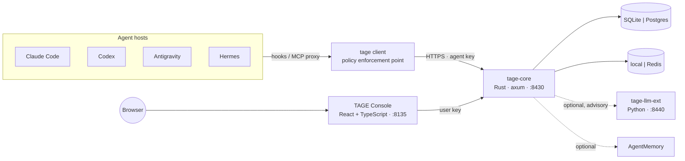

# Team Agents Governance Engine (TAGE)

> **Empowering enterprise AI teams with unified control, cross-agent coordination, and policy-driven governance.**

[繁體中文](README.zh-tw.md)

TAGE is a self-hosted governance engine for teams that run many AI agents (Claude Code, Codex, Antigravity, Hermes, or your own). It decides what each agent may do, coordinates agents that work together, measures what they cost, and keeps a registry of every agent and its lifecycle. It is the companion of [AgentMemory](https://github.com/hsuanshao/AgentMemory): AgentMemory remembers, TAGE governs. Each runs without the other; together they share departments, teams and members.

> **Status: design phase (M0).** This repository currently holds the architecture and specifications. Nothing here is ready to deploy yet. See the [roadmap](.docs/roadmap/ROADMAP.md).

## The four pillars

| Pillar | What it answers | Module |
| --- | --- | --- |
| **Access & Tool-Use Governance** | May this agent call this tool with these arguments, now? Who approves when the answer is "ask a human"? | `policy` |
| **Orchestration & Cross-Agent Coordination** | How do two or more agents share work: who holds the write lease, who reviews, when is an issue really closed? | `coordination` |
| **Observability & Cost Management** | What did each agent do, which tools did it call, how many tokens did it use, and is the team still within budget? | `observability` |
| **Lifecycle & Registry** | Which agents exist, who owns them, which version is active, and how do we suspend one immediately? | `registry` |

## Technology

| Part | Stack |
| --- | --- |
| Backend | Rust (MSRV 1.88), axum, tokio, sqlx / rusqlite, Cedar policy engine; Clean Architecture crates |
| LLM extension (optional) | Python 3.12, FastAPI, uv; advisory only, never given tools |
| Console | React 18, TypeScript, Vite, TanStack Query; Hono BFF that holds no server key |
| Methods | DDD for the model, BDD (Gherkin) for behaviour, TDD for every change |

## Documentation (collaborator limited)

Design documents live in `.docs/`, which is kept locally and not versioned; the links below work in a maintainer's checkout. User-facing documentation moves to `docs/` (English and Traditional Chinese) with the first release. Start at the [documentation index](.docs/README.md).

- [Vision and scope](.docs/product/VISION.md)
- [Architecture](.docs/architecture/ARCHITECTURE.md) and [module specifications](.docs/architecture/modules/README.md)
- [Ubiquitous language](.docs/domain/UBIQUITOUS-LANGUAGE.md) and [context map](.docs/domain/CONTEXT-MAP.md)
- [API conventions](.docs/api/API.md)
- [Development workflow (design-first, BDD → TDD)](.docs/engineering/DEVELOPMENT-WORKFLOW.md), [testing](.docs/engineering/TESTING.md), [conventions](.docs/engineering/CONVENTIONS.md)
- [Threat model](.docs/security/THREAT-MODEL.md)
- [Architecture decision records](.docs/architecture/adr/README.md)

## License

To be decided before the first release (AgentMemory uses BUSL-1.1 for the server and MIT for clients).
