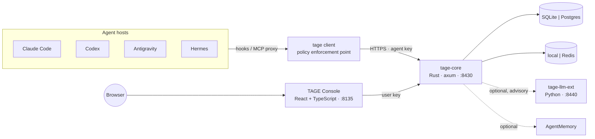

# Team Agents Governance Engine (TAGE)

> **讓企業 AI 團隊以統一的控管、跨 agent 協調與政策驅動的治理運作。**

[English](README.md)

TAGE 是自架的治理引擎，給同時運作許多 AI agent（Claude Code、Codex、Antigravity、Hermes 或自製 agent）的團隊使用。它決定每個 agent 能做什麼、協調一起工作的 agent、計算它們花了多少，並登錄每個 agent 與它的生命週期。它是 [AgentMemory](https://github.com/hsuanshao/AgentMemory) 的搭配產品：AgentMemory 負責記憶，TAGE 負責治理。兩者都能單獨運作；一起使用時共用部門、團隊與成員。

> **狀態：設計階段（M0）。** 目前 repo 只有架構與規格，還不能部署。見 [roadmap](.docs/roadmap/ROADMAP.zh-tw.md)。

## 四大支柱

| 支柱 | 回答的問題 | 模組 |
| --- | --- | --- |
| **存取與工具使用治理** | 這個 agent 現在能不能用這組參數呼叫這個工具？答案是「問人」的時候由誰核准？ | `policy` |
| **編排與跨 agent 協調** | 兩個以上的 agent 如何分工：誰持有寫入租約、誰審查、議題什麼時候才算真的結案？ | `coordination` |
| **可觀測性與成本管理** | 每個 agent 做了什麼、呼叫了哪些工具、用了多少 token，團隊還在預算內嗎？ | `observability` |
| **生命週期與登錄** | 有哪些 agent、誰擁有、哪個版本在使用中、怎麼立刻停用一個 agent？ | `registry` |

## 技術

| 部分 | 技術 |
| --- | --- |
| 後端 | Rust（MSRV 1.88）、axum、tokio、sqlx / rusqlite、Cedar 政策引擎；Clean Architecture 分層 crate |
| LLM 擴充（選用） | Python 3.12、FastAPI、uv；只提供建議，永遠不給工具 |
| Console | React 18、TypeScript、Vite、TanStack Query；Hono BFF，不持有伺服器 key |
| 方法 | DDD 建模、BDD（Gherkin）描述行為、TDD 驅動每一次修改 |

## 文件 (專案共同維護者限定)

設計文件放在 `.docs/`，只保留在本機、不進版控；以下連結在維護者的工作目錄中有效。第一次發版時，給使用者看的文件會放到 `docs/`（英文與繁體中文）。從[文件索引](.docs/README.zh-tw.md)開始。

- [願景與範圍](.docs/product/VISION.zh-tw.md)
- [架構](.docs/architecture/ARCHITECTURE.zh-tw.md)與[模組規格](.docs/architecture/modules/README.zh-tw.md)
- [統一語言](.docs/domain/UBIQUITOUS-LANGUAGE.zh-tw.md)與 [context map](.docs/domain/CONTEXT-MAP.zh-tw.md)
- [API 慣例](.docs/api/API.zh-tw.md)
- [開發流程（設計先行、BDD → TDD）](.docs/engineering/DEVELOPMENT-WORKFLOW.zh-tw.md)、[測試](.docs/engineering/TESTING.zh-tw.md)、[慣例](.docs/engineering/CONVENTIONS.zh-tw.md)
- [威脅模型](.docs/security/THREAT-MODEL.zh-tw.md)
- [架構決策紀錄（ADR）](.docs/architecture/adr/README.zh-tw.md)

## 授權

第一次發版前決定（AgentMemory 的 server 採 BUSL-1.1，client 採 MIT）。
